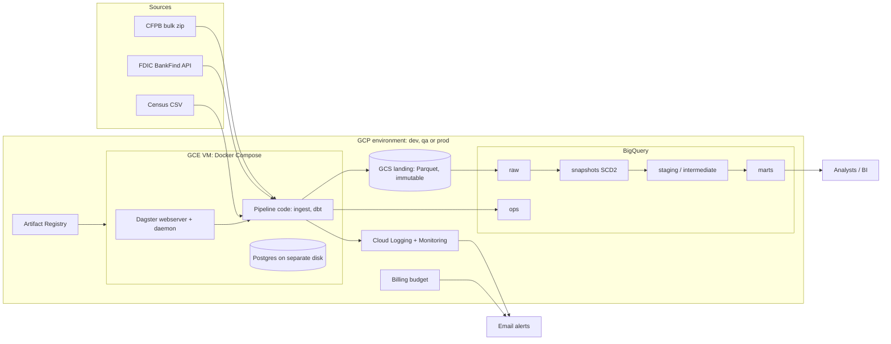

# Complaint Canary

Fraud and scam early-warning signals from public consumer complaints.

Banks and regulators usually notice a new scam, or a company whose customers are being hit, weeks late. Complaint Canary ingests the CFPB Consumer Complaint Database every day (18.3 million complaints), tracks how each complaint changes, classifies the fraud-related ones, and flags companies and states whose fraud complaints rise sharply against their own baseline.

It is built for fraud-strategy analysts, compliance teams and regulators, and as a reference data-engineering project: a daily ELT pipeline with an integrity gate, SCD2 history, a star schema, three environments, and build-once promotion.

Complaints are self-reported and lag the events they describe. The alerts are triage signals for an analyst, not detected fraud.

## Status and key links

- **Status**: version 0.1.0. Runs locally end to end; cloud deployment is verified by the owner per environment.
- **Design**: [docs/planning/iteration-5.md](docs/planning/iteration-5.md) (approved plan), [docs/alert-rule.md](docs/alert-rule.md), [docs/runbook.md](docs/runbook.md)
- **Diagrams**: [diagrams/](diagrams/)
- **Data catalogue and lineage (demo)**: dbt docs on GitHub Pages, `https://<owner>.github.io/complaint-canary/`, published by the `main` workflow
- **Issue tracker**: GitHub Issues on this repository
- **Licence**: [MIT](LICENSE). Source data: CFPB (CC0), FDIC and US Census Bureau (public domain).

## Quick start

Prerequisites: [uv](https://docs.astral.sh/uv/) 0.12 or later. Python 3.14 is installed by uv. No cloud account is needed.

```bash
make setup      # uv sync, and .env from .env.example
make fixture    # synthetic CFPB, FDIC and Census files in data/fixture
make run        # the daily job, on DuckDB
make status
```

`make status` prints the snapshot ledger:

```text
snapshot_date=2026-09-30  state=published  row_count=5119  new_count=5119  changed_count=0  deleted_count=0
```

The fixture plants one scam spike. The digest it produces is in `data/landing/digests/`.

## Usage

| Task | Command |
|---|---|
| Apply the next day's snapshot (30 new complaints, 15 changed, 2 removed) | `make day2` |
| Browse assets, lineage, checks and runs | `make ui`, then http://localhost:3000 |
| Same, in Docker with Postgres-backed run history | `make up` |
| Show the ledger | `uv run canary status` |
| Rebuild history from landed snapshots | `uv run canary replay --from 2026-09-30 --drop-history` |
| Generate dbt docs into `site/` | `make docs` |
| Run against the real sources | Remove the three `CANARY_*_URL` lines from `.env`, then `make run` (downloads 353 MB) |

After `make day2`:

```text
snapshot_date=2026-10-01  state=published  row_count=5147  new_count=30  changed_count=15  deleted_count=2
snapshot_date=2026-09-30  state=published  row_count=5119  new_count=5119  changed_count=0  deleted_count=0
```

The digest for the planted spike:

```text
| Severity | Scope | Entity | Fraud category | Complaints | Baseline median | Lift | z-score |
| critical | company | JPMORGAN CHASE & CO. | scam | 45 | 9.0 | 5.0x | 12.0 |
| high | state | Texas | scam | 29 | 11.5 | 2.5x | 5.2 |
```

Query the local warehouse with any DuckDB client:

```sql
select week_start, scope, fraud_category, complaint_count, robust_z_score, severity, alert_status
from marts.fct_scam_alerts;
```

Main tables:

| Table | Content |
|---|---|
| `marts.fct_scam_alerts` | Weekly signals per fraud category and company or state |
| `marts.fct_complaints` | One row per complaint, with dimensions `dim_company`, `dim_product`, `dim_issue`, `dim_geography`, `dim_date` |
| `marts.fct_complaint_status_history` | Every observed version of every complaint |
| `marts.fct_alert_backtest` | The alert rule replayed over history |
| `ops.snapshot_ledger`, `ops.load_audit`, `ops.dq_results`, `ops.publication_lag` | Operations |

## Configuration

Settings are environment variables, read from `.env` locally. [.env.example](.env.example) lists them all with safe placeholders. Never commit `.env`.

| Variable | Default | Meaning |
|---|---|---|
| `CANARY_ENV` | `local` | `local`, `dev`, `qa` or `prod` |
| `CANARY_WAREHOUSE` | `duckdb` | `duckdb` or `bigquery` |
| `CANARY_CFPB_URL`, `CANARY_FDIC_URL`, `CANARY_CENSUS_URL` | The public sources | An https URL or a local file |
| `CANARY_LANDING_URI` | `data/landing` | A directory or `gs://bucket/prefix` |
| `CANARY_SAMPLE_PERCENT` | `100` | Stable sample of complaints to keep (DEV uses 5) |
| `CANARY_GATE_OVERRIDE` | `false` | Skip the row-count and delete-guard checks for one run |
| `CANARY_DBT_FULL_REFRESH` | `false` | Rebuild incremental models in full (DEV and QA) |
| `CANARY_GCP_PROJECT`, `CANARY_BQ_LOCATION`, `CANARY_DATASET_PREFIX` | empty | BigQuery target |
| `CANARY_ENABLE_SCHEDULES` | `false` | Turn on the daily schedule and sensors (PROD) |
| `CANARY_EVENT_SINK` | `stdout` | `cloud_logging` in the cloud |
| `CANARY_ZIP_POLICY_TAG` | empty | BigQuery policy tag applied to `fct_complaints.zip_code` |
| `DAGSTER_PG_PASSWORD` | none | Local Docker Compose only |

In the cloud these are written to the VM by Terraform. The only secret, the Dagster database password, is generated by Terraform, kept in Secret Manager and read at container start.

Alert thresholds and gate limits are dbt variables in [dbt/dbt_project.yml](dbt/dbt_project.yml).

## Architecture



One daily run:

1. **Ingest**: download the CFPB bulk file, verify its checksum and its 15-column header, and stream it to Parquet in the landing zone.
2. **Gate**: load the snapshot to `raw` and test it (IDs, dates, row count against the last snapshot, share of complaints that would be deleted). A snapshot that fails is rejected and changes nothing.
3. **History**: a dbt snapshot records new, changed and removed complaints as SCD2 rows, stamped with the snapshot date so a re-run or replay gives the same result.
4. **Model**: dbt builds staging, intermediate and mart models, running each model's tests before anything downstream.
5. **Publish**: the ledger row is marked published, the digest is written, and an event is emitted for monitoring.

| Concern | Choice |
|---|---|
| Orchestration | Dagster: every dbt model is an asset and every dbt test an asset check |
| Transformation and data quality | dbt: tests, unit tests, enforced contracts on marts, source freshness |
| Warehouse | BigQuery in the cloud, DuckDB locally and in CI; the same SQL runs on both |
| Infrastructure | Terraform, one module, three environments |
| CI/CD | GitHub Actions with Workload Identity Federation; no service-account keys |

Other diagrams: [pipeline](diagrams/pipeline.mmd), [data model](diagrams/data-model.mmd), [CI/CD](diagrams/cicd.mmd).

## Development guide

```bash
make setup
make format     # ruff format and autofix
make lint       # ruff, and sqlfluff in the BigQuery dialect
make test
make docker     # build the image
make tf-check   # terraform fmt -check and validate
```

Layout:

| Path | Content |
|---|---|
| `src/complaint_canary/` | Ingestion, warehouse adapters, ledger, pipeline steps, Dagster definitions, CLI |
| `dbt/` | Models, the SCD2 snapshot, seeds, macros, tests |
| `tests/` | pytest suite |
| `terraform/` | Infrastructure; `envs/` holds one variable file per environment |
| `deploy/` | Dagster instance config and the Compose file used on the cloud VMs |
| `.github/` | Workflows and composite actions |

Conventions:

- SQL is written in the subset BigQuery and DuckDB share. The few differences are isolated in `dbt/macros/cross_db.sql`.
- Curated knowledge lives in seeds: `fraud_taxonomy.csv` and `company_overrides.csv`.
- Python that Dagster inspects (`assets.py`, `definitions.py`) must not use `from __future__ import annotations`.

## Testing

```bash
make test
```

| Layer | What it covers |
|---|---|
| pytest, unit | Zip-to-Parquet conversion, header contract, truncated and corrupt files, stable sampling, FDIC pagination and retry, Census parsing, ledger ordering rules, event format, digest |
| pytest, end to end | The Dagster job for two consecutive snapshots on DuckDB; history and counts; the planted spike alerts and the planted flood does not; a re-run changes nothing; an older snapshot is refused; a truncated snapshot is rejected and leaves history and marts untouched; replay rebuilds identical history; the freshness watchdog |
| dbt data tests | Keys, relationships, accepted values, uniqueness of grains, history starts at the environment's first snapshot, taxonomy drift |
| dbt unit tests | Every condition of the alert rule, week maturity, fraud classification across both CFPB taxonomy eras, name normalisation |
| Integrity gate | Five dbt tests on each incoming snapshot, run before history can change |

CI runs all of it on every push, on DuckDB. BigQuery is first exercised in DEV.

## Deployment and operations

### Environments

| | DEV | QA | PROD |
|---|---|---|---|
| Data | Stable 5% sample | Full | Full |
| VM | Started by deploys, then stopped | Started by deploys, then stopped | Always on |
| Deployed by | Push to a feature branch | The same push, after DEV passes | Merge to `main` |

The image is built once, on the branch. Its tag is a hash of the Git tree entries that go into it, which is the same for a branch head and for its merge commit. QA marks the image it tested; `main` deploys only an image carrying that mark, by digest. See [diagrams/cicd.mmd](diagrams/cicd.mmd).

### Prerequisites

- A GCP account with billing, and three empty projects (or one shared project).
- On your user: Owner on each project, and Billing Account Costs Manager for the budget alert.
- Terraform 1.9 or later, the gcloud CLI, and `gcloud auth login` plus `gcloud auth application-default login`.
- A GitHub repository. Environment branch rules and branch protection need a public repository or a paid plan.

### Estimated cost

About $46 to $57 a month for all three environments in `us-central1`: PROD about $35 (the always-on `e2-medium` VM is $24.50), QA about $6, DEV about $5, plus up to $10 of BigQuery queries beyond the free 1 TiB. Prices were checked against secondary sources, not the official calculator; confirm before relying on them. Each environment has a budget alert (DEV 15, QA 15, PROD 70, in the billing account's currency; change `budget_amount` in `terraform/envs/<env>.tfvars` if that is not US dollars).

### Deploy

1. Create a bucket for Terraform state:
   ```bash
   gcloud storage buckets create gs://<state-bucket> --project <project> --location us-central1 --uniform-bucket-level-access
   ```
2. For `dev`, then `qa`, then `prod`: copy `terraform/envs/local.tfvars.example` to `terraform/envs/<env>.local.tfvars`, fill it in, and apply.
   ```bash
   make tf-apply ENV=dev TF_STATE_BUCKET=<state-bucket>
   terraform -chdir=terraform output github_environment_variables
   ```
3. In GitHub, create Environments `dev`, `qa` and `prod` and add the eight variables from that output to each. Limit `prod` to the `main` branch. Protect `main`: require a pull request, require the branch to be up to date, require the `branch` workflow. Set Pages to deploy from GitHub Actions.
4. Push a feature branch. The `branch` workflow deploys DEV, then QA. The first QA run loads the full history.
5. Open a pull request and merge it. The `main` workflow deploys PROD. PROD then runs daily at 11:00 UTC; to run it at once, use "Materialize all" in the Dagster UI.

### Monitor

- **Dagster UI**: `make ui-tunnel ENV=prod`, then http://localhost:3000.
- **Email alerts** (Cloud Monitoring): run failed or snapshot rejected; no snapshot published in 26 hours; orchestrator heartbeat missing; data quality warning; VM disk or CPU; budget at 50, 80 and 100%.
- **Dashboard**: "Complaint Canary (<env>)" in Cloud Monitoring.
- **Tables**: `ops.snapshot_ledger`, `ops.load_audit`, `ops.dq_results`; failing rows in the `dq_failures` dataset.

### Back up and restore

- SCD2 history is the only state that cannot be rebuilt from the source. It is protected by 90 days of landed snapshots (replayable), a weekly BigQuery table snapshot kept 4 weeks, and 7 days of time travel.
- Dagster's run history sits on a separate disk with daily snapshots kept 7 days. Losing it does not affect the data.
- Procedures: [docs/runbook.md](docs/runbook.md).

### Troubleshoot

[docs/runbook.md](docs/runbook.md) has a section per alert. Common first-deploy problems:

| Symptom | Cause and fix |
|---|---|
| `terraform apply` fails on the budget | With a permission error: you lack Billing Account Costs Manager. Set `enable_budget = false`. |
| `terraform apply` fails on the taxonomy or policy tag | Set `enable_policy_tags = false`. |
| Workflow cannot authenticate to GCP | A GitHub Environment variable is missing or `github_repository` in the tfvars does not match the repository. |
| "The VM did not become ready" | Read `/var/log/canary-startup.log` on the VM. The first boot installs Docker and takes a few minutes. |
| `main` fails with "No QA-passed image" | The merged branch was not up to date with `main`, or its `branch` run did not finish. Re-run the branch. |
| Re-applying after a destroy fails on the workload identity pool | Deleted pools are kept for 30 days. Undelete it, or wait. |

### Tear down

```bash
make tf-destroy ENV=prod TF_STATE_BUCKET=<state-bucket>
make tf-destroy ENV=qa TF_STATE_BUCKET=<state-bucket>
make tf-destroy ENV=dev TF_STATE_BUCKET=<state-bucket>
gcloud storage rm -r gs://<state-bucket>
```

Destroy in that order: each environment holds a permission on the one before it. To pause spending without destroying anything, stop the PROD VM: `gcloud compute instances stop canary-prod`.

## Security and data handling

- **Reporting a vulnerability**: use GitHub's private vulnerability reporting (Security → Report a vulnerability) on this repository. Please do not open a public issue.
- **Data**: all three sources are public. Complaints carry no names or narratives. State and ZIP code are quasi-identifiers; `zip_code` is restricted by a BigQuery policy tag, and analysts are granted the marts without that tag's reader role.
- **Access**: no inbound access to the VMs except SSH through Identity-Aware Proxy; the Dagster UI is reached through an SSH tunnel. Each environment has its own runtime and deploy identities with the roles they need. GitHub authenticates with short-lived tokens; the PROD identity accepts only the `main` branch.
- **Secrets**: none in the repository or the image. `.env` and `*.local.tfvars` are git-ignored. Terraform state holds the generated database password, so keep the state bucket private.
- **Retention**: landed snapshots 90 days in PROD (14 in QA, 7 in DEV); raw snapshot partitions 7 days; failing test rows 30 days; SCD2 history and marts until deleted. `terraform destroy` removes everything.
- **Source terms**: requests use the HTTP client's default User-Agent and one download a day.
