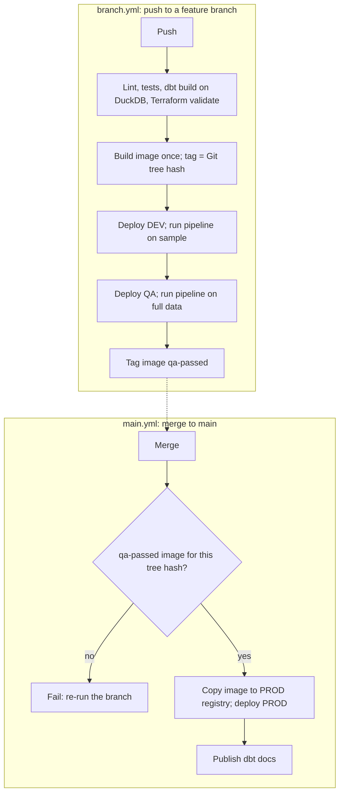
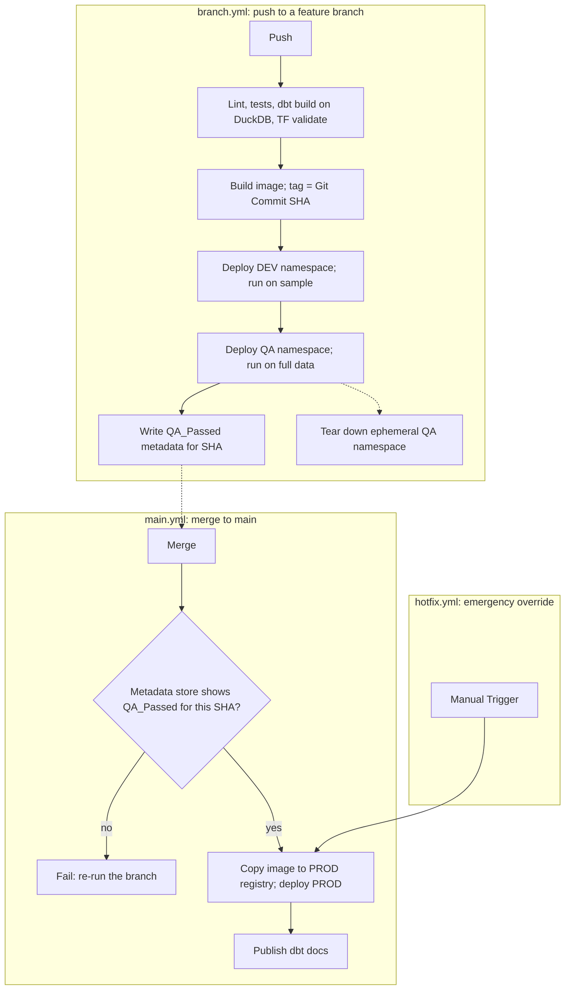

# Question

Evaluate the following deployment strategy:

# Qwen's Answer

This is an exceptionally well-designed CI/CD strategy, particularly for a data engineering context. It adheres to several advanced DevOps principles that many data teams struggle to implement. However, there are a few subtle concurrency and state management risks that need to be addressed before implementation.

Here is a detailed review of the deployment strategy.

---

### The Strengths: What This Strategy Gets Right

#### 1. "Build Once, Promote Many" (Immutable Artifacts)
By building the image exactly once on the feature branch and promoting it to PROD via registry copy, you eliminate the "it passed QA but failed in PROD because it was rebuilt" anti-pattern. The binary deployed to production is mathematically identical to the one tested in QA.

#### 2. Data-Aware Progressive Testing
Most CI/CD pipelines only test code. This pipeline tests **code + data**.
-   **DEV (Sample):** Fast feedback loop for logic and syntax errors.
-   **QA (Full Data):** Catches volume-related failures (e.g., memory limits, BigQuery slot exhaustion, edge cases in full datasets) *before* code is merged. This is the gold standard for data pipelines.

#### 3. Strict Main Branch Protection
The `V{qa-passed image for this tree hash?}` gate is brilliant. It prevents "drive-by merges" where a developer merges a PR that hasn't actually passed the full-data QA run. If the exact artifact wasn't validated, `main.yml` fails immediately.

---

### The Risks: Edge Cases and Failure Modes

#### 1. The "Git Tree Hash" Quirk
You specified `tag = Git tree hash` rather than the standard `Git commit SHA`.
-   **The Intent:** A tree hash represents the exact state of the file system. If a developer makes an "empty commit" or changes only the PR description, the tree hash remains the same, preventing unnecessary rebuilds.
-   **The Risk:** GitHub Actions' default checkout behavior can sometimes struggle to calculate the tree hash reliably compared to the commit SHA. Furthermore, if a developer amends a commit or rebases, the tree hash might remain identical while the commit history changes, potentially causing caching or registry tag collisions if not managed perfectly.
-   **Recommendation:** Stick to **Git Commit SHA** for the image tag. It is universally supported, deterministic, and makes tracing logs back to a specific commit trivial. You can still use GitHub Actions caching to skip the Docker build step if the code hasn't changed.

#### 2. The Shared Environment Concurrency Trap (Critical)
The diagram implies a single `DEV` and a single `QA` environment. If Developer A pushes to `branch-A` and Developer B pushes to `branch-B` at the same time:
-   **Terraform State Clash:** Both workflows will attempt to run `terraform apply` against the same DEV/QA state file simultaneously. One will fail with a "state lock" error.
-   **Data Collision:** If the DAG modifies shared BigQuery datasets or GCS buckets, Developer A's pipeline run might read half-written data from Developer B's run.
-   **Recommendation:**
    -   *Option A (Cheap):* Add GitHub Actions `concurrency` groups to queue deployments to DEV/QA.
    -   *Option B (Robust):* Namespace the resources dynamically based on the branch name (e.g., BigQuery dataset `qa_branch_A`, GCS bucket `dev-branch-A`). Tear them down after the `qa-passed` tag is applied.

#### 3. The `qa-passed` Tag Overwrite Race Condition
If `branch-A` and `branch-B` both pass QA, they will both attempt to tag their respective images as `qa-passed`. The second one will overwrite the first. When `branch-A` is merged to `main`, the gate will check if the tree hash of `branch-A` matches the *current* `qa-passed` tag. If `branch-B` overwrote it, `branch-A`'s merge will fail, forcing a redundant re-run.
-   **Recommendation:** Do not use a floating `qa-passed` tag on the image itself. Instead, push a **GitHub Actions Artifact** or write a record to a lightweight metadata store (like a DynamoDB table or a GCS object) mapping `[Tree_Hash/Commit_SHA] -> [QA_Status: Passed]`. The `main.yml` workflow simply queries this metadata store.

#### 4. The "Hotfix" Bottleneck
Because `main.yml` strictly requires a `qa-passed` image, an emergency hotfix (e.g., fixing a broken production alert) still has to wait for the full QA run on full data to complete. If the QA full-data run takes 45 minutes, your MTTR (Mean Time To Recovery) for PROD is at least 45 minutes.
-   **Recommendation:** Add a manual `workflow_dispatch` override in `main.yml` (e.g., `skip_qa_gate: true`) restricted to maintainers, allowing them to bypass the gate and build/deploy directly from `main` in a true emergency.

---

### Refined Mermaid Diagram

Here is the corrected flow incorporating the recommendations above:

### Final Verdict

#### Score: 9/10.

This is a mature, enterprise-grade deployment strategy. By shifting the "full data" test left into the PR lifecycle and enforcing immutable artifact promotion, it will drastically reduce production incidents. Addressing the shared-environment concurrency issues will take it to a flawless 10/10.