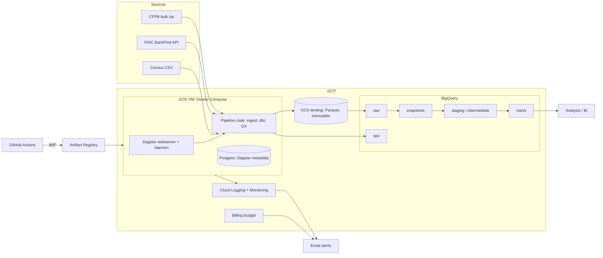
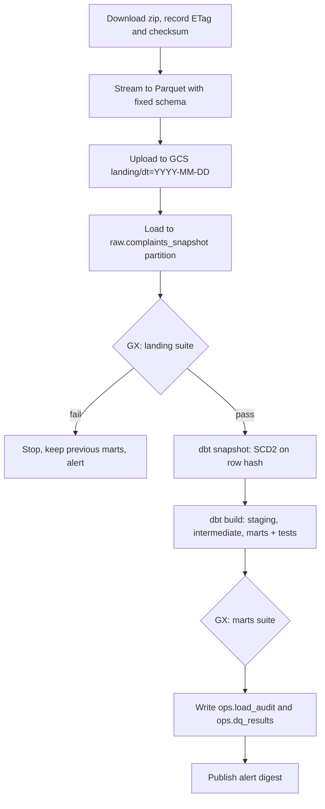
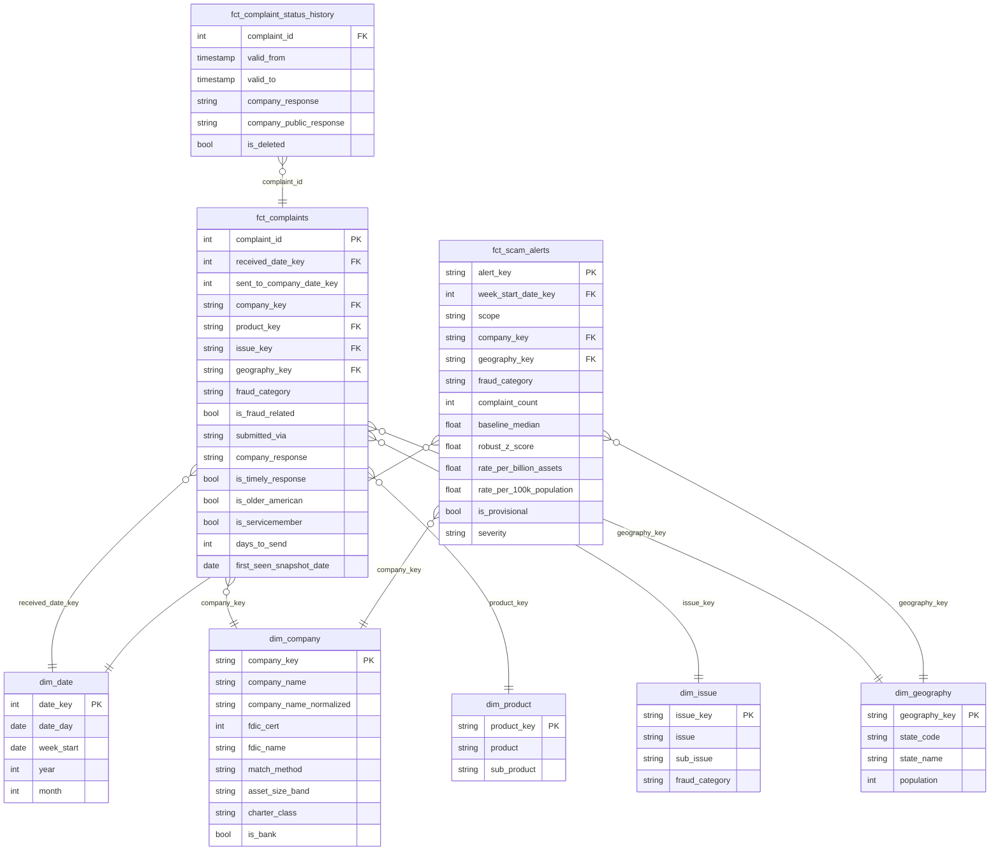

# Iteration 1: Scam Radar

Fraud and scam early-warning from public consumer complaints. Status: PLANNING (awaiting "APPROVED - implement").

## 1. Problem and outcome

Banks and regulators notice new scam types and spiking institutions weeks late. Scam Radar ingests the CFPB complaint database daily, classifies fraud-related complaints, and raises alerts when a company or state spikes against its own baseline and its peers.

Consumers: fraud-strategy analysts, compliance, regulators.

Outputs:
- `fct_scam_alerts`: spikes by fraud category x company and fraud category x state.
- `fct_complaints` star schema for ad-hoc analysis.
- Complaint status history (how company responses change over time).

## 2. Findings that changed the design

Checked on 2026-10-09.

| Finding | Consequence |
|---|---|
| CFPB stopped publishing complaint narratives (announced 2026-08-14). Records now have 15 structured fields. | No free-text analysis. Fraud classification uses product / issue / sub-issue. |
| About 27,000 new complaints per day (55,084 for 1–2 Sep 2026); 18.3M records in total. | Re-pulling a look-back window through the search API is too heavy. |
| The search API returned 403 (Akamai) for a custom User-Agent and 200 for the default one. | API is a fragile dependency. Not used. |
| Bulk file `complaints.csv.zip` is rebuilt daily: 353 MB zipped, 5.5 GB unzipped. | Ingest the full daily snapshot; detect changes by row hash. |
| Records have no `updated_at`; company response fields change after publication. | SCD2 snapshot gives change history. |
| Python 3.15.0 final is due 2026-10-09; Dagster and Great Expectations pin `<3.15`. | Use Python 3.14. Move to 3.15 when the dependencies allow. |

## 3. Data sources

| Source | Access | Cadence | Licence | Use |
|---|---|---|---|---|
| CFPB Consumer Complaint Database, `files.consumerfinance.gov/ccdb/complaints.csv.zip` | HTTPS file, no account | Daily | CC0 | Complaints |
| FDIC BankFind `api.fdic.gov/banks/institutions` | REST JSON, no key | Weekly | US public domain | Bank identity, asset size, peer groups |
| US Census state population estimates (`www2.census.gov`, NST-EST CSV) | HTTPS file | Yearly | Public domain | Per-capita rates |

## 4. Stack

| Concern | Choice | Reason |
|---|---|---|
| Cloud | GCP | BigQuery is serverless and nearly free at this volume |
| Storage | GCS (landing), BigQuery (warehouse) | ELT |
| Transformation | dbt-core + dbt-bigquery | SQL in the warehouse, tests, docs, snapshots |
| Orchestration | Dagster OSS | Asset lineage, dbt integration, asset checks |
| Validation | Great Expectations (GX Core) | Required |
| Runtime | Docker Compose on one GCE VM | Cheapest way to run the Dagster UI and daemon |
| IaC | Terraform | Required |
| CI/CD | GitHub Actions with Workload Identity Federation | No service-account keys |
| Language | Python 3.14, uv | See section 2 |
| Local warehouse | DuckDB (dbt `local` target) | Full pipeline runs on a laptop and in CI without cloud |

Trade-off: the VM is a budget choice. Production would use Dagster+ or GKE.

Trade-off: two dbt targets (DuckDB and BigQuery) require portable SQL via dbt cross-database macros. It is the only way to test end to end before cloud deployment.

## 5. Architecture

## 6. Pipeline

Daily at 11:00 UTC (the CFPB file is rebuilt around 09:15 UTC).

- Idempotent: a run is keyed by snapshot date; re-running replaces that partition. Unchanged ETag skips the load.
- Change capture: SCD2 on a hash of all business columns; rows missing from the new snapshot are closed as deleted.
- Backfill: the first run loads all 18.3M rows through the same path.
- FDIC and Census are separate Dagster assets on their own schedules.
- Local mode: a 5,000-row fixture, filesystem landing, DuckDB.

## 7. Data model

Layers: `raw` (as delivered, typed as strings) → `snapshots` (SCD2) → `staging` (typed, renamed, current rows) → `intermediate` (classification, entity resolution) → `marts` (star schema).

- Fraud taxonomy: versioned dbt seed mapping (product, issue, sub-issue) to `fraud_category` (scam, unauthorised transaction, identity theft, account takeover, fraud-alert handling, not fraud). A test fails when new unmapped combinations exceed a threshold.
- Entity resolution: normalise names in SQL (case, punctuation, legal suffixes), exact match to FDIC institution or holding-company name, plus a curated override seed. Unmatched companies are non-banks. Match rate is a tracked quality metric. No fuzzy matching.
- Alert rule: weekly count against the trailing 8-week median using a robust z-score (MAD), with a minimum-volume floor. Weeks younger than 15 days are `is_provisional` because CFPB publishes up to 15 days after receipt.
- BigQuery: `fct_complaints` partitioned by received month, clustered by `company_key`, `fraud_category`.

## 8. Dimension coverage

| Dimension | Design |
|---|---|
| Data storage | GCS landing (Parquet, immutable, versioned, 30-day lifecycle); BigQuery datasets per layer; raw snapshot partitions expire after 7 days |
| Data security | No public ingress; SSH and UI through IAP only; OS Login; least-privilege service accounts per workload; WIF for GitHub (no keys); uniform bucket access with public access prevention; Secret Manager; policy tag on `zip_code`; marts exposed read-only to an analyst group |
| Data integration | Three sources, two protocols (bulk file, paginated REST); retries with backoff; ETag and checksum; schema enforced at landing |
| Data transformation | ELT with dbt: staging, intermediate, marts; SCD2 snapshot; incremental marts |
| Discoverability | dbt docs published to GitHub Pages; descriptions and labels persisted to BigQuery; Dagster asset catalog with owners and tags |
| Data quality | GX suites at landing and marts (gate the pipeline); dbt generic, singular and unit tests; results in `ops.dq_results`; GX Data Docs in GCS |
| Data lineage | Dagster asset graph from source to mart (dbt models as assets); dbt docs DAG; `snapshot_date` and `run_id` columns on raw rows |
| Monitoring and observability | `ops.load_audit` (rows, bytes, ETag, duration, changed/new/deleted counts); Dagster freshness checks; Ops Agent to Cloud Logging; Cloud Monitoring dashboard |
| Alerting | Cloud Monitoring policies to email: run failure, no successful run in 26 h, VM disk or CPU; billing budget alert; data-quality failure; weekly scam-alert digest |
| Data architecture | Layered warehouse, Kimball star schema, section 5 |
| Orchestration | Dagster: assets, schedules, sensors, retries, asset checks |
| CI/CD | Section 9 |
| IaC | Terraform, GCS remote state, section 10 |
| Tests | Section 9 |

## 9. Testing and CI/CD

Tests:
- pytest unit: zip-to-Parquet converter, FDIC client pagination (mocked HTTP), name normaliser, config.
- pytest integration: full Dagster job on the fixture against DuckDB.
- dbt: generic tests (unique, not_null, relationships, accepted_values), singular tests, unit tests for alert and classification logic.
- GX: landing and marts suites run in the integration test.
- Static: ruff, sqlfluff, `terraform fmt -check`, `terraform validate`, Dagster definitions load.

Workflows:
- `ci.yml` (PR, push): `uv sync --locked`, ruff, sqlfluff, pytest, dbt build on DuckDB, Terraform fmt and validate, Docker build.
- `cd.yml` (main): WIF auth, build and push image to Artifact Registry, deploy to the VM over IAP, publish dbt docs to GitHub Pages.
- Terraform apply is manual, run by the owner.

## 10. Terraform scope

APIs, GCS buckets (landing, GX docs), BigQuery datasets, policy-tag taxonomy, service accounts and IAM, Workload Identity pool and provider, Artifact Registry, VPC with IAP-only firewall, VM with startup script, Secret Manager secrets, log-based metrics, alert policies, email notification channel, billing budget ($100; 50 / 80 / 100 %).

## 11. Cost estimate

Monthly, us-central1, list prices from memory; to be re-checked against the pricing calculator during implementation.

| Item | Assumption | USD / month |
|---|---|---|
| GCE e2-medium | 730 h | 24.50 |
| Boot disk | 30 GB balanced | 3.00 |
| External IPv4 | 730 h (avoids Cloud NAT, about $32) | 3.65 |
| GCS | about 15 GB | 0.30 |
| BigQuery storage | about 50 GB | 1.00 |
| BigQuery queries | about 0.6 TiB, inside the 1 TiB free tier; `maximum_bytes_billed` set | 0–5 |
| Artifact Registry | about 2 GB | 0.20 |
| Logging, Monitoring, Secret Manager | free tier | 0–1 |
| **Total** | | **about 33–39** |

One month of running fits the $100 budget with margin. Stopping the VM between demos cuts the bill to under $10.

## 12. What you must prepare

- GCP account with billing enabled, and a new empty project.
- Roles on your user: Owner on the project; Billing Account Costs Manager on the billing account (for the budget).
- Billing account ID and an alert email address (Terraform variables).
- `gcloud auth login` and `gcloud auth application-default login`.
- One `gcloud` command to create the Terraform state bucket (provided at hand-off).
- An empty GitHub repository.
- GitHub repository variables, taken from Terraform outputs: `GCP_PROJECT_ID`, `GCP_REGION`, `GCP_WIF_PROVIDER`, `GCP_DEPLOY_SA`, `GCP_VM_NAME`, `GCP_VM_ZONE`. No secrets are needed.
- Already installed locally: uv 0.12, Docker 29, Terraform 1.16, gcloud 586. `gh` is missing; optional.

## 13. Risks

| Risk | Mitigation |
|---|---|
| CFPB blocks cloud IPs or changes the file | Plain User-Agent, retries, ETag check; untested from GCP until your cloud run |
| A dependency lacks a Python 3.14 wheel | Fall back to 3.13 and report it |
| DuckDB and BigQuery SQL drift | Cross-database macros; CI runs DuckDB, cloud run is the BigQuery check |
| Policy tags or budget need extra permissions | Both are toggled by Terraform variables |
| Low bank match rate | Override seed for the top companies; metric tracked |

## 14. Out of scope

Dashboards, ML models, streaming, complaint narratives.

## 15. Decisions for you

1. GCP, or do you prefer Azure?
2. Dagster on a VM with the UI (about $35/month), or Cloud Run jobs with no cloud UI (about $5/month)?
3. Add a Looker Studio dashboard? It is free but configured by hand, outside Terraform.
4. Project name `scam-radar`?
