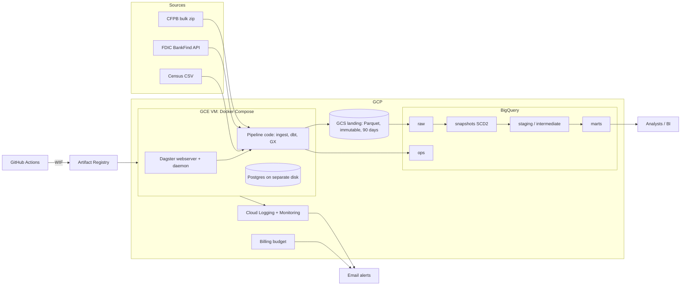
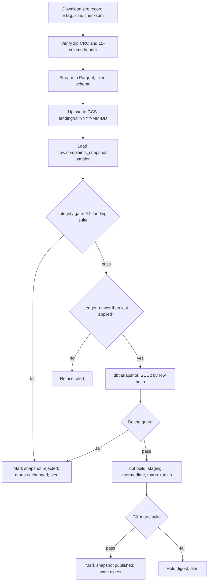
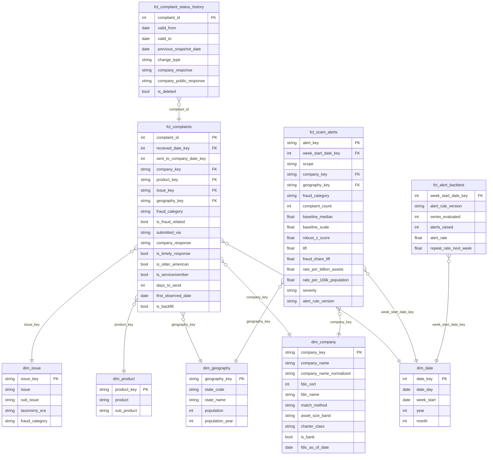

# Iteration 2: Scam Radar

Fraud and scam early-warning signals from public consumer complaints. Status: PLANNING (awaiting "APPROVED - implement").

Supersedes iteration 1. Revised after the review in `docs/llm-evaluations/chatgpt/iteration-1.md`.

## 0. Response to the review

The review names four risk areas without specifics. Each is a real gap in iteration 1.

| Review point | Verdict | Change |
|---|---|---|
| Snapshot reconciliation | Accepted | Integrity gate before the SCD2 step, delete guard, ordered snapshot ledger, replay from landing, backups (6.1) |
| Historical data semantics | Accepted | Explicit time axes, backfill flag, taxonomy eras, split change types (7.1) |
| Alert statistical validity | Accepted | Reframed as triage signals; new rule with scale floor, lift and share conditions, mature weeks only, backtest (7.2) |
| Single-VM orchestration | Partly accepted | VM made disposable, metadata disk backed up, overlap and retry controls, recovery time stated (6.2). Still one VM: budget. |
| Full-snapshot ingestion limits scale | Rejected | The source offers no deltas (filtered exports are capped at 100,000 rows). A full pass is 5.5 GB a day and costs almost nothing. Ceiling stated in 6.3. |
| Too many technologies | Rejected | Terraform, Great Expectations, an orchestrator, Docker and GitHub Actions are project constraints. Nothing removed. |
| Operational requirements underspecified | Accepted | Service levels, retention table, runbook, mart contracts (8, 9) |

## 1. Problem and outcome

Banks and regulators notice new scam types and spiking institutions weeks late. Scam Radar ingests the CFPB complaint database daily, classifies fraud-related complaints, and flags companies and states whose fraud complaints rise against their own baseline.

Complaints are a self-reported, lagging proxy. Alerts are triage signals for an analyst, not detected fraud. No ground-truth labels exist, so precision and recall cannot be measured.

Consumers: fraud-strategy analysts, compliance, regulators.

Outputs:
- `fct_scam_alerts`: weekly signals by fraud category x company and fraud category x state.
- `fct_complaints` star schema.
- `fct_complaint_status_history`: observed changes to each complaint.
- `fct_alert_backtest`: how the alert rule behaves over history.

## 2. Source facts

Checked on 2026-10-09.

| Fact | Consequence |
|---|---|
| Narratives removed (release 24, Sept 2026); "consumer disputed" and "consent" removed from exports (release 22). 15 fields remain. | Schema contract is exactly 15 columns. Classification uses product / issue / sub-issue. |
| About 27,000 new complaints a day; 18.3M records. | Look-back pulls through the search API are too heavy. |
| Search API returned 403 for a custom User-Agent. Filtered CSV export is capped at 100,000 rows (release 23). | API not used. |
| Bulk `complaints.csv.zip` rebuilt daily: 353 MB zipped, 5.5 GB unzipped. | Daily full snapshot; change detection by row hash. |
| No `updated_at`; response fields change after publication. | SCD2. |
| Products and issues were reorganised on 2017-04-24; older complaints keep their original labels. | Fraud taxonomy maps both eras. |
| Published up to 15 days after receipt. | Recent weeks are incomplete. |
| Dagster and Great Expectations pin Python `<3.15`. | Python 3.14. |

## 3. Data sources

| Source | Access | Cadence | Licence | Use |
|---|---|---|---|---|
| CFPB Consumer Complaint Database, `files.consumerfinance.gov/ccdb/complaints.csv.zip` | HTTPS file | Daily | CC0 | Complaints |
| FDIC BankFind `api.fdic.gov/banks/institutions` | REST JSON, no key | Weekly | US public domain | Bank identity, asset size, peer groups |
| US Census state population estimates (`www2.census.gov`) | HTTPS file | Yearly | Public domain | Per-capita rates |

## 4. Stack

| Concern | Choice |
|---|---|
| Cloud | GCP |
| Storage | GCS landing, BigQuery warehouse |
| Transformation | dbt-core + dbt-bigquery (ELT) |
| Orchestration | Dagster OSS |
| Validation | Great Expectations (GX Core) |
| Runtime | Docker Compose on one GCE VM |
| IaC | Terraform |
| CI/CD | GitHub Actions with Workload Identity Federation |
| Language | Python 3.14, uv |
| Local warehouse | DuckDB (dbt `local` target), so the pipeline runs on a laptop and in CI |

## 5. Architecture

## 6. Pipeline

Daily at 11:00 UTC (the CFPB file is rebuilt around 09:15 UTC).

### 6.1 Snapshot reconciliation

- **Ledger**: `ops.snapshot_ledger` holds one row per snapshot date with state `landed → validated → applied → published` or `rejected`, plus ETag, checksum, row count, and new / changed / deleted counts.
- **Integrity gate** (before SCD2 is touched):
  - header is exactly the 15 expected columns
  - `complaint_id` is unique and not null
  - row count is at least 99.5% of the last applied snapshot
  - growth is at most 1% per elapsed day
  - `date_received` parses and is not in the future
- **Delete guard**: fail if rows missing from the new snapshot exceed 0.5% of active rows. A truncated file cannot mass-close history.
- **Ordering**: snapshots apply strictly in date order. A date at or before the last applied one is refused.
- **Deterministic timestamps**: SCD2 validity uses the snapshot date, not the run clock, so a re-run gives the same result.
- **Idempotency**: an unchanged ETag skips the run. A re-run of a rejected or unapplied date replaces its raw partition.
- **Missed days**: the next run applies the latest file. The ledger records the gap; each history row carries `previous_snapshot_date` to bound when the change happened.
- **Recovery**: the SCD2 table is the only state that cannot be re-derived from the source.
  - Landing Parquet is kept 90 days; a `replay` job rebuilds SCD2 from it in order.
  - Weekly BigQuery table snapshot of SCD2, kept 4 weeks.
  - BigQuery time travel covers the last 7 days.

### 6.2 Orchestration reliability

- All pipeline state lives in GCS and BigQuery. The VM is disposable and is rebuilt by Terraform plus its startup script; target recovery time 15 minutes.
- Dagster metadata (Postgres) sits on a separate persistent disk with a daily disk snapshot, 7 kept.
- VM auto-restart; containers restart unless stopped.
- One snapshot run at a time (concurrency limit 1); run timeout 2 hours.
- Download retries: 3, exponential backoff.
- A missed schedule self-heals on the next run; the only loss is one day of change granularity.
- Not built: high availability. Production path is Dagster+ or GKE.

### 6.3 Scale ceiling

Conversion streams with constant memory. A daily pass scans about 20 GB in BigQuery. The design holds to roughly ten times the current volume before the full-snapshot diff needs to change.

### 6.4 Other assets

FDIC (weekly) and Census (yearly) are separate Dagster assets. Local mode uses a 5,000-row fixture, filesystem landing and DuckDB.

## 7. Data model

Layers: `raw` (as delivered, strings) → `snapshots` (SCD2) → `staging` (typed, current rows) → `intermediate` (classification, entity resolution) → `marts` (star schema).

### 7.1 Historical semantics

- **Three time axes, never mixed**:
  - `received_date`: when CFPB received the complaint.
  - `first_observed_date`: the first snapshot that contained it.
  - SCD2 validity: when a change was observed.
- **Backfill**: rows in the first snapshot get `is_backfill = true` and a null `first_observed_date`. Status history starts on the project start date; a test enforces that no history row predates it.
- **Change types**: two hashes per row. `status` covers company response, timeliness and public response. `attribute` covers everything else, including a company rename by CFPB. A rename is not counted as a status change.
- **Taxonomy eras**: the fraud taxonomy seed maps pre- and post-2017-04-24 labels to one stable `fraud_category`. A test fails when unmapped combinations exceed a threshold.
- **FDIC attributes**: current values only (Type 1), stamped with `fdic_as_of_date`. Rates for old weeks use today's asset size; documented limitation.
- **Population**: joined by year; the latest vintage covers later years.
- **Entity resolution**: names normalised in SQL, exact match to FDIC institution or holding-company name, plus a curated override seed. Unmatched companies are non-banks. Match rate is tracked. No fuzzy matching.

### 7.2 Alert rule

Evaluated weekly per series (fraud category x company, fraud category x state).

- **Eligibility**: baseline median of at least 5 complaints a week. Series with less history are labelled "insufficient history", never alerted.
- **Mature weeks only**: a week is evaluated once its last day is 15 days old. Younger weeks are shown as provisional counts.
- **Baseline**: the 12 mature weeks before the evaluated week.
- **Scale**: `max(1.4826 × MAD, sqrt(median), 1)`. The square-root floor covers the zero-MAD case in count data.
- **Alert when all hold**:
  - robust z-score of at least 3.5
  - lift of at least 1.5 times the baseline median
  - at least 10 complaints above baseline
  - (company scope) the fraud share of that company's complaints also rises
- **Why the share condition**: it separates a fraud-specific spike from a company-wide complaint flood.
- **Severity**: tiered by z-score.
- **Versioning**: thresholds are dbt variables; each alert stores `alert_rule_version`.
- **Backtest**: `fct_alert_backtest` replays the rule from 2018 to now and reports alerts per week, alert rate, and how often an alert repeats the next week. Thresholds are tuned on it; results go in the README.
- **Tests**: dbt unit tests for zero MAD, sparse series, a new company, and the provisional boundary.
- **Out of scope**: seasonality models, and a completeness curve from `first_observed_date` (needs several weeks of snapshots first).

### 7.3 Physical design

`fct_complaints` is partitioned by received month and clustered by `company_key`, `fraud_category`. Marts have enforced dbt model contracts.

## 8. Dimension coverage

| Dimension | Design |
|---|---|
| Data storage | GCS landing (Parquet, immutable, versioned); BigQuery datasets per layer; retention table in section 9 |
| Data security | No public ingress; SSH and UI through IAP only; OS Login; least-privilege service accounts per workload; WIF for GitHub (no keys); uniform bucket access with public access prevention; Secret Manager; policy tag on `zip_code`; marts read-only to an analyst group |
| Data integration | Three sources, two protocols; retries with backoff; ETag and checksum; schema contract at landing |
| Data transformation | ELT with dbt: staging, intermediate, marts; SCD2 snapshot; incremental marts |
| Discoverability | dbt docs on GitHub Pages; descriptions and labels persisted to BigQuery; Dagster asset catalog with owners and tags |
| Data quality | Integrity gate and delete guard; GX suites at landing and marts; dbt generic, singular and unit tests; model contracts; results in `ops.dq_results`; GX Data Docs in GCS |
| Data lineage | Dagster asset graph from source to mart; dbt docs DAG; `snapshot_date` and `run_id` on raw rows; snapshot ledger |
| Monitoring and observability | `ops.snapshot_ledger`, `ops.load_audit`; Dagster freshness checks; Ops Agent to Cloud Logging; Cloud Monitoring dashboard |
| Alerting | Email on: run failure, rejected snapshot, no published snapshot in 26 hours, VM disk or CPU, budget thresholds. Weekly scam-signal digest. |
| Data architecture | Layered warehouse, Kimball star schema |
| Orchestration | Dagster: assets, schedules, sensors, retries, asset checks, concurrency limit |
| CI/CD | Section 10 |
| IaC | Section 11 |
| Tests | Section 10 |

## 9. Operations

Service levels:
- Marts published by 13:00 UTC daily.
- Rejected snapshots never reach marts.
- VM rebuild within 15 minutes.

| Data | Retention |
|---|---|
| GCS landing Parquet | 90 days |
| `raw.complaints_snapshot` partitions | 7 days |
| SCD2 history | Indefinite; weekly table snapshot kept 4 weeks |
| Marts | Rebuilt from SCD2 |
| Postgres disk snapshots | 7 days |
| Logs | 30 days |

`docs/runbook.md` covers: failed download, rejected snapshot, replay from landing, VM rebuild, taxonomy drift, restoring SCD2.

## 10. Testing and CI/CD

Tests:
- pytest unit: zip-to-Parquet converter, integrity gate, ledger ordering, FDIC client pagination (mocked HTTP), name normaliser.
- pytest integration: full Dagster job on the fixture against DuckDB, including a truncated-file case and an out-of-order case.
- dbt: generic tests, singular tests, unit tests for alert and classification logic.
- GX: landing and marts suites run in the integration test.
- Static: ruff, sqlfluff, `terraform fmt -check`, `terraform validate`, Dagster definitions load.

Workflows:
- `ci.yml` (PR, push): `uv sync --locked`, ruff, sqlfluff, pytest, dbt build on DuckDB, Terraform fmt and validate, Docker build.
- `cd.yml` (main): WIF auth, build and push image to Artifact Registry, deploy to the VM over IAP, publish dbt docs to GitHub Pages.
- Terraform apply is manual, run by the owner.

## 11. Terraform scope

APIs, GCS buckets (landing, GX docs) with lifecycle rules, BigQuery datasets, policy-tag taxonomy, service accounts and IAM, Workload Identity pool and provider, Artifact Registry, VPC with IAP-only firewall, VM with startup script, data disk with snapshot schedule, Secret Manager secrets, log-based metrics, alert policies, email notification channel, billing budget ($100; 50 / 80 / 100 %).

## 12. Cost estimate

Monthly, us-central1. Prices are from memory; to be re-checked against the pricing calculator during implementation. Parquet size per day (about 0.5 GB) is an estimate.

| Item | Assumption | USD / month |
|---|---|---|
| GCE e2-medium | 730 h | 24.50 |
| Boot disk + data disk | 30 GB + 10 GB balanced | 4.00 |
| Disk snapshots | 7 daily, small | 0.50 |
| External IPv4 | 730 h (avoids Cloud NAT, about $32) | 3.65 |
| GCS | about 45 GB (90 days of Parquet) | 1.00 |
| BigQuery storage | about 55 GB incl. table snapshots | 1.10 |
| BigQuery queries | about 0.6 TiB, inside the 1 TiB free tier; `maximum_bytes_billed` set | 0–5 |
| Artifact Registry | about 2 GB | 0.20 |
| Logging, Monitoring, Secret Manager | free tier | 0–1 |
| **Total** | | **about 35–41** |

One month fits the $100 budget. Stopping the VM between demos cuts the bill to under $10.

## 13. What you must prepare

- GCP account with billing enabled, and a new empty project.
- Roles on your user: Owner on the project; Billing Account Costs Manager on the billing account.
- Billing account ID and an alert email address (Terraform variables).
- `gcloud auth login` and `gcloud auth application-default login`.
- One `gcloud` command to create the Terraform state bucket (provided at hand-off).
- An empty GitHub repository.
- GitHub repository variables from Terraform outputs: `GCP_PROJECT_ID`, `GCP_REGION`, `GCP_WIF_PROVIDER`, `GCP_DEPLOY_SA`, `GCP_VM_NAME`, `GCP_VM_ZONE`. No secrets.
- Installed already: uv 0.12, Docker 29, Terraform 1.16, gcloud 586. `gh` is missing; optional.

## 14. Risks

| Risk | Mitigation |
|---|---|
| CFPB blocks cloud IPs or changes the file | Plain User-Agent, retries, schema contract; untested from GCP until the cloud run |
| A dependency lacks a Python 3.14 wheel | Fall back to 3.13 and report it |
| DuckDB and BigQuery SQL drift | Cross-database macros; CI runs DuckDB, the cloud run checks BigQuery |
| Policy tags or budget need extra permissions | Both toggled by Terraform variables |
| Low bank match rate | Override seed for the top companies; metric tracked |
| Alert thresholds too noisy or too quiet | Tuned on the backtest; versioned |
| Gate thresholds reject a legitimate large CFPB correction | Manual override flag recorded in the ledger; runbook entry |

## 15. Out of scope

Dashboards, ML models, streaming, complaint narratives, high availability, seasonality models.

## 16. Open decisions (defaults from iteration 1 assumed)

1. Cloud: GCP.
2. Runtime: Dagster on a VM with the UI (about $35/month) rather than Cloud Run jobs (about $5/month, no cloud UI).
3. No Looker Studio dashboard.
4. Project name `scam-radar`.
