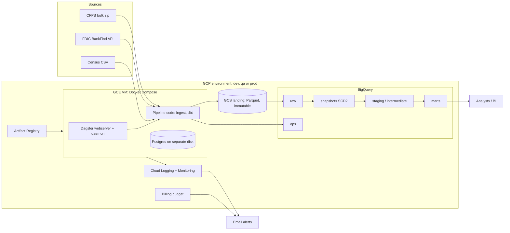
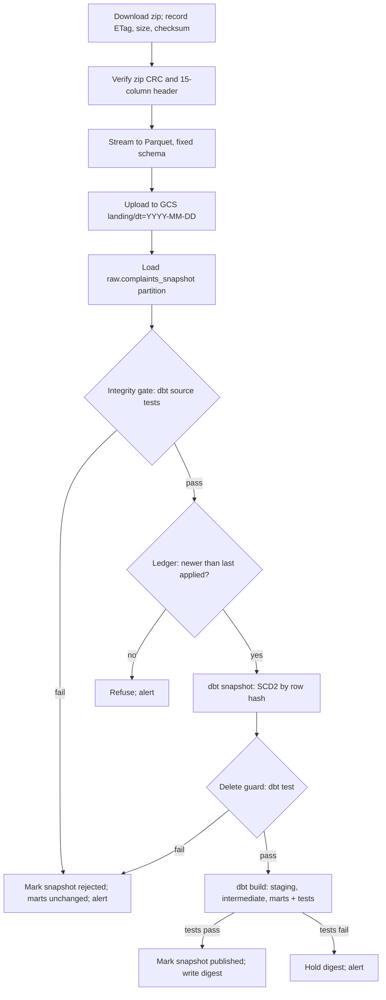
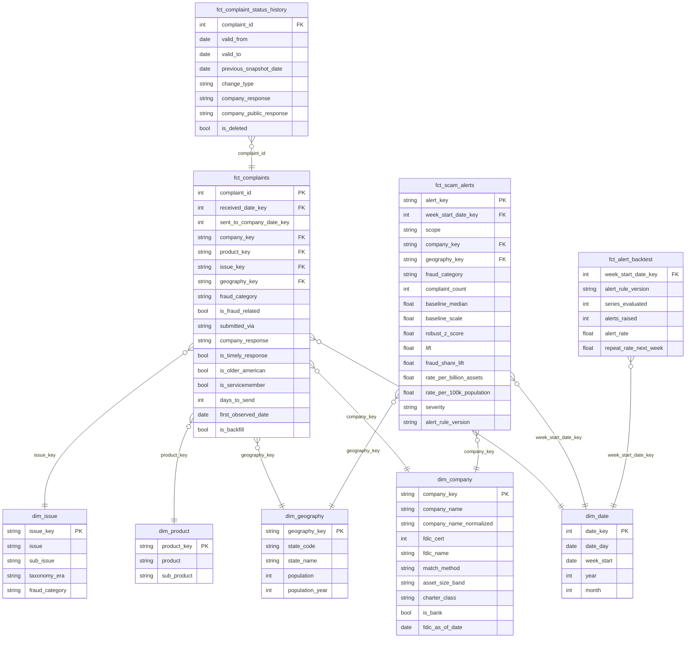
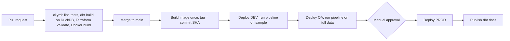

# Iteration 3: Scam Radar

Fraud and scam early-warning signals from public consumer complaints. Status: PLANNING (awaiting "APPROVED - implement").

Supersedes iteration 2. Revised for the updated `anthropic-skills:de-project` constraints and a second pass over `docs/llm-evaluations/chatgpt/iteration-1.md`.

## 0. What changed

### 0.1 Updated skill constraints

| Constraint change | Effect on the plan |
|---|---|
| Assume DEV, QA and PROD environments | Three isolated environments from one Terraform module; build once, promote the same image dev → qa → prod; prod behind manual approval (section 10) |
| Use the transformation tool's built-in data quality checks; Great Expectations only if none exist | dbt has them. Great Expectations is removed. All validation is dbt tests, unit tests and model contracts (section 8) |
| Orchestrator: choose what fits (Airflow, Dagster, Prefect, Kestra) | Dagster kept; reason in section 4 |
| Docker for build and container deployment, local or cloud | Unchanged: Docker Compose locally and on the VM |

### 0.2 Review verdicts

The review file is unchanged. Verdicts from iteration 2 stand, with two updates.

| Review point | Verdict | Where |
|---|---|---|
| Snapshot reconciliation | Accepted | 6.1 |
| Historical data semantics | Accepted | 7.1 |
| Alert statistical validity | Accepted | 7.2 |
| Operational requirements underspecified | Accepted | 9 |
| Single-VM orchestration | Partly accepted | 6.2. New: every release runs in QA on full data before prod. Still one VM per environment: budget. |
| Too many technologies | Now partly accepted (was rejected) | Great Expectations removed. The rest is required by the constraints. |
| Full-snapshot ingestion limits scale | Rejected | Source offers no deltas; filtered exports are capped at 100,000 rows. Ceiling in 6.3. |

## 1. Problem and outcome

Banks and regulators notice new scam types and spiking institutions weeks late. Scam Radar ingests the CFPB complaint database daily, classifies fraud-related complaints, and flags companies and states whose fraud complaints rise against their own baseline.

Complaints are a self-reported, lagging proxy. Alerts are triage signals for an analyst, not detected fraud. No ground-truth labels exist, so precision and recall cannot be measured.

Consumers: fraud-strategy analysts, compliance, regulators.

Outputs:
- `fct_scam_alerts`: weekly signals by fraud category x company and fraud category x state.
- `fct_complaints` star schema.
- `fct_complaint_status_history`: observed changes to each complaint.
- `fct_alert_backtest`: how the alert rule behaves over history.

## 2. Source facts

Checked on 2026-10-09.

| Fact | Consequence |
|---|---|
| Narratives removed (release 24, Sept 2026); "consumer disputed" and "consent" removed from exports (release 22). 15 fields remain. | Schema contract is exactly 15 columns. Classification uses product / issue / sub-issue. |
| About 27,000 new complaints a day; 18.3M records. | Look-back pulls through the search API are too heavy. |
| Search API returned 403 for a custom User-Agent. Filtered CSV export is capped at 100,000 rows (release 23). | API not used. |
| Bulk `complaints.csv.zip` rebuilt daily: 353 MB zipped, 5.5 GB unzipped. | Daily full snapshot; change detection by row hash. |
| No `updated_at`; response fields change after publication. | SCD2. |
| Products and issues were reorganised on 2017-04-24; older complaints keep their original labels. | Fraud taxonomy maps both eras. |
| Published up to 15 days after receipt. | Recent weeks are incomplete. |
| Dagster pins Python `<3.15`. | Python 3.14. |

## 3. Data sources

| Source | Access | Cadence | Licence | Use |
|---|---|---|---|---|
| CFPB Consumer Complaint Database, `files.consumerfinance.gov/ccdb/complaints.csv.zip` | HTTPS file | Daily | CC0 | Complaints |
| FDIC BankFind `api.fdic.gov/banks/institutions` | REST JSON, no key | Weekly | US public domain | Bank identity, asset size, peer groups |
| US Census state population estimates (`www2.census.gov`) | HTTPS file | Yearly | Public domain | Per-capita rates |

## 4. Stack

| Concern | Choice | Reason |
|---|---|---|
| Cloud | GCP | BigQuery is serverless and nearly free at this volume |
| Storage | GCS landing, BigQuery warehouse | ELT |
| Transformation and data quality | dbt-core + dbt-bigquery | SQL in the warehouse; built-in tests, unit tests, contracts, snapshots, docs |
| Orchestration | Dagster OSS | The project is a daily batch of data assets built mostly by dbt. Dagster models assets natively, maps each dbt model and test to an asset and asset check, and gives source-to-mart lineage. Airflow and Kestra are task-centric and heavier to host; Prefect has no asset lineage or comparable dbt mapping. |
| Runtime | Docker Compose on one GCE VM per environment | Cheapest way to run the Dagster UI and daemon |
| IaC | Terraform | Required |
| CI/CD | GitHub Actions with Workload Identity Federation | Required; no service-account keys |
| Language | Python 3.14, uv | Section 2 |
| Local warehouse | DuckDB (dbt `local` target) | Pipeline runs on a laptop and in CI without cloud |

## 5. Architecture

## 6. Pipeline

Daily at 11:00 UTC in prod (the CFPB file is rebuilt around 09:15 UTC).

### 6.1 Snapshot reconciliation

- **Ledger**: `ops.snapshot_ledger` holds one row per snapshot date with state `landed → validated → applied → published` or `rejected`, plus ETag, checksum, row count, and new / changed / deleted counts.
- **Integrity gate** (dbt tests on the raw partition, before SCD2 is touched):
  - `complaint_id` is unique and not null
  - row count is at least 99.5% of the last applied snapshot
  - growth is at most 1% per elapsed day
  - `date_received` parses and is not in the future
- **File preconditions** (ingestion code, before load): zip CRC passes and the header is exactly the 15 expected columns.
- **Delete guard**: fail if rows missing from the new snapshot exceed 0.5% of active rows. A truncated file cannot mass-close history.
- **Ordering**: snapshots apply strictly in date order. A date at or before the last applied one is refused.
- **Deterministic timestamps**: SCD2 validity uses the snapshot date, not the run clock.
- **Idempotency**: an unchanged ETag skips the run. A re-run of a rejected or unapplied date replaces its raw partition.
- **Missed days**: the next run applies the latest file. The ledger records the gap; each history row carries `previous_snapshot_date`.
- **Recovery**: the SCD2 table is the only state that cannot be re-derived from the source.
  - Landing Parquet is kept 90 days in prod; a `replay` job rebuilds SCD2 from it in order.
  - Weekly BigQuery table snapshot of SCD2, kept 4 weeks.
  - BigQuery time travel covers the last 7 days.

### 6.2 Orchestration reliability

- All pipeline state lives in GCS and BigQuery. The VM is disposable; Terraform plus its startup script rebuild it. Target recovery time 15 minutes.
- Dagster metadata (Postgres) sits on a separate persistent disk with a daily disk snapshot, 7 kept (prod).
- VM auto-restart; containers restart unless stopped.
- One snapshot run at a time; run timeout 2 hours; download retries 3 with backoff.
- A missed schedule self-heals on the next run; the only loss is one day of change granularity.
- Every release runs the full pipeline in QA before prod.
- Not built: high availability. Production path is Dagster+ or GKE.

### 6.3 Scale ceiling

Conversion streams with constant memory. A daily pass scans about 20 GB in BigQuery. The design holds to roughly ten times the current volume before the full-snapshot diff needs to change.

### 6.4 Other assets

FDIC (weekly) and Census (yearly) are separate Dagster assets.

## 7. Data model

Layers: `raw` (as delivered, strings) → `snapshots` (SCD2) → `staging` (typed, current rows) → `intermediate` (classification, entity resolution) → `marts` (star schema).

### 7.1 Historical semantics

- **Three time axes, never mixed**:
  - `received_date`: when CFPB received the complaint.
  - `first_observed_date`: the first snapshot that contained it.
  - SCD2 validity: when a change was observed.
- **Backfill**: rows in the first snapshot get `is_backfill = true` and a null `first_observed_date`. Status history starts on the environment's start date; a test enforces that no history row predates it.
- **Change types**: two hashes per row. `status` covers company response, timeliness and public response. `attribute` covers everything else, including a company rename by CFPB.
- **Taxonomy eras**: the fraud taxonomy seed maps pre- and post-2017-04-24 labels to one stable `fraud_category`. A test fails when unmapped combinations exceed a threshold.
- **FDIC attributes**: current values only (Type 1), stamped with `fdic_as_of_date`. Rates for old weeks use today's asset size; documented limitation.
- **Population**: joined by year; the latest vintage covers later years.
- **Entity resolution**: names normalised in SQL, exact match to FDIC institution or holding-company name, plus a curated override seed. Unmatched companies are non-banks. Match rate is tracked. No fuzzy matching.

### 7.2 Alert rule

Evaluated weekly per series (fraud category x company, fraud category x state).

- **Eligibility**: baseline median of at least 5 complaints a week. Series with less history are labelled "insufficient history", never alerted.
- **Mature weeks only**: a week is evaluated once its last day is 15 days old. Younger weeks are shown as provisional counts.
- **Baseline**: the 12 mature weeks before the evaluated week.
- **Scale**: `max(1.4826 × MAD, sqrt(median), 1)`. The square-root floor covers the zero-MAD case in count data.
- **Alert when all hold**:
  - robust z-score of at least 3.5
  - lift of at least 1.5 times the baseline median
  - at least 10 complaints above baseline
  - (company scope) the fraud share of that company's complaints also rises
- **Why the share condition**: it separates a fraud-specific spike from a company-wide complaint flood.
- **Severity**: tiered by z-score.
- **Versioning**: thresholds are dbt variables; each alert stores `alert_rule_version`.
- **Backtest**: `fct_alert_backtest` replays the rule from 2018 to now and reports alerts per week, alert rate, and how often an alert repeats the next week. Thresholds are tuned on it; results go in the README.
- **Out of scope**: seasonality models, and a completeness curve from `first_observed_date`.

### 7.3 Physical design

`fct_complaints` is partitioned by received month and clustered by `company_key`, `fraud_category`. Marts have enforced dbt model contracts.

## 8. Dimension coverage

| Dimension | Design |
|---|---|
| Data storage | GCS landing (Parquet, immutable, versioned); BigQuery datasets per layer; retention in section 9 |
| Data security | One project per environment; no public ingress; SSH and UI through IAP only; OS Login; least-privilege service accounts per workload; WIF for GitHub (no keys), one deploy identity per environment; uniform bucket access with public access prevention; Secret Manager; policy tag on `zip_code`; marts read-only to an analyst group |
| Data integration | Three sources, two protocols; retries with backoff; ETag and checksum; schema contract at landing |
| Data transformation | ELT with dbt: staging, intermediate, marts; SCD2 snapshot; incremental marts |
| Discoverability | dbt docs on GitHub Pages; descriptions and labels persisted to BigQuery; Dagster asset catalog with owners and tags |
| Data quality | dbt only: source tests (integrity gate), generic and singular tests, unit tests, model contracts, source freshness. Failing rows stored (`store_failures`); results loaded to `ops.dq_results`; each test is a Dagster asset check. |
| Data lineage | Dagster asset graph from source to mart; dbt docs DAG; `snapshot_date` and `run_id` on raw rows; snapshot ledger |
| Monitoring and observability | `ops.snapshot_ledger`, `ops.load_audit`, `ops.dq_results`; Dagster freshness checks; Ops Agent to Cloud Logging; Cloud Monitoring dashboard |
| Alerting | Email on: run failure, rejected snapshot, no published snapshot in 26 hours (prod), VM disk or CPU, budget thresholds. Weekly scam-signal digest. |
| Data architecture | Layered warehouse, Kimball star schema, three environments |
| Orchestration | Dagster: assets, schedules, sensors, retries, asset checks, concurrency limit |
| CI/CD | Section 10 |
| IaC | Section 11 |
| Tests | Section 10 |

## 9. Operations

Service levels (prod):
- Marts published by 13:00 UTC daily.
- Rejected snapshots never reach marts.
- VM rebuild within 15 minutes.

| Data | Prod | QA | Dev |
|---|---|---|---|
| GCS landing Parquet | 90 days | 14 days | 7 days |
| `raw.complaints_snapshot` partitions | 7 days | 7 days | 7 days |
| SCD2 history | Indefinite; weekly table snapshot kept 4 weeks | Disposable | Disposable |
| Postgres disk snapshots | 7 days | None | None |
| Logs | 30 days | 30 days | 30 days |

`docs/runbook.md` covers: failed download, rejected snapshot, replay from landing, VM rebuild, taxonomy drift, restoring SCD2, rolling back a release.

## 10. Environments, testing and CI/CD

### 10.1 Environments

| | Local | DEV | QA | PROD |
|---|---|---|---|---|
| Purpose | Development, CI | First cloud deploy, smoke test | Release rehearsal on full data | Scheduled service |
| Warehouse | DuckDB | BigQuery | BigQuery | BigQuery |
| Data | 5,000-row fixture | Stable 5% sample (hash of `complaint_id`) | Full | Full |
| VM | None | Stopped; started by deploys | Stopped; started by deploys | Always on |
| Schedule | None | None | None | Daily |
| Deploy trigger | None | Merge to `main` | After DEV passes | Manual approval after QA passes |

- Isolation: one GCP project per environment. All resource names carry the environment, so a single project also works.
- Same Terraform module, same image, same dbt project. Only variables differ.
- dbt targets: `local`, `dev`, `qa`, `prod`.

### 10.2 Tests

- pytest unit: zip-to-Parquet converter, file preconditions, ledger ordering, FDIC client pagination (mocked HTTP), name normaliser, sampling.
- pytest integration: full Dagster job on the fixture against DuckDB, including a truncated-file case and an out-of-order case.
- dbt: source tests, generic tests, singular tests, unit tests for alert and classification logic, contracts.
- Static: ruff, sqlfluff, `terraform fmt -check`, `terraform validate`, Dagster definitions load.

### 10.3 Workflows

- Promotion copies the same image digest between environment registries; nothing is rebuilt.
- QA is the first place the BigQuery SQL dialect and real volume are exercised; a failed dbt test there blocks prod.
- GitHub Environments `dev`, `qa`, `prod` hold per-environment variables; `prod` requires a reviewer.
- Rollback: redeploy the previous image digest.
- Terraform apply is manual, run by the owner, in order dev → qa → prod.

## 11. Terraform scope

One root module; `envs/dev.tfvars`, `envs/qa.tfvars`, `envs/prod.tfvars`; one state prefix per environment.

Per environment: APIs, GCS buckets with lifecycle rules, BigQuery datasets, policy-tag taxonomy, service accounts and IAM, Workload Identity pool and provider, Artifact Registry, VPC with IAP-only firewall, VM with startup script, data disk (snapshot schedule in prod), Secret Manager secrets, log-based metrics, alert policies, email notification channel, billing budget.

Budgets: dev $15, qa $15, prod $70 (total $100); thresholds 50 / 80 / 100 %.

## 12. Cost estimate

Monthly, us-central1. Prices are from memory; to be re-checked against the pricing calculator during implementation. Parquet size per day (about 0.5 GB) is an estimate.

| Item | Prod | QA | Dev |
|---|---|---|---|
| GCE e2-medium | 24.50 (730 h) | 0.70 (about 20 h) | 0.35 (about 10 h) |
| Boot + data disks (30 + 10 GB) | 4.00 | 4.00 | 4.00 |
| Disk snapshots | 0.50 | 0 | 0 |
| External IPv4 | 3.65 | 0.10 | 0.05 |
| GCS | 1.00 | 0.15 | 0.05 |
| BigQuery storage | 1.10 | 0.60 | 0.10 |
| Artifact Registry | 0.20 | 0.20 | 0.20 |
| Logging, Monitoring, Secret Manager | 0–1 | 0 | 0 |
| **Subtotal** | **about 35–36** | **about 6** | **about 5** |

BigQuery queries: about 0.7 TiB a month across all three, inside the 1 TiB free tier; `maximum_bytes_billed` set. Allow $0–5.

**Total: about $46–52 a month.** One month fits the $100 budget. Stopping the prod VM between demos cuts the bill to about $20.

## 13. What you must prepare

- GCP account with billing enabled.
- Three new empty projects (dev, qa, prod), or one project for all three.
- Roles on your user: Owner on each project; Billing Account Costs Manager on the billing account.
- Billing account ID and an alert email address (Terraform variables).
- `gcloud auth login` and `gcloud auth application-default login`.
- One `gcloud` command to create the Terraform state bucket (provided at hand-off).
- An empty GitHub repository. Required reviewers on an environment need a public repository or a paid plan.
- GitHub Environments `dev`, `qa`, `prod`, each with variables from Terraform outputs: `GCP_PROJECT_ID`, `GCP_REGION`, `GCP_WIF_PROVIDER`, `GCP_DEPLOY_SA`, `GCP_VM_NAME`, `GCP_VM_ZONE`. No secrets.
- Installed already: uv 0.12, Docker 29, Terraform 1.16, gcloud 586. `gh` is missing; optional.

## 14. Risks

| Risk | Mitigation |
|---|---|
| CFPB blocks cloud IPs or changes the file | Plain User-Agent, retries, schema contract; first checked in DEV |
| A dependency lacks a Python 3.14 wheel | Fall back to 3.13 and report it |
| DuckDB and BigQuery SQL drift | Cross-database macros; DEV and QA run BigQuery before prod |
| Deploy over IAP SSH from GitHub Actions fails | Exercised in DEV first; manual deploy command in the runbook |
| Policy tags or budget need extra permissions | Both toggled by Terraform variables |
| Low bank match rate | Override seed for the top companies; metric tracked |
| Alert thresholds too noisy or too quiet | Tuned on the backtest; versioned |
| Gate thresholds reject a legitimate large CFPB correction | Manual override flag recorded in the ledger; runbook entry |

## 15. Out of scope

Dashboards, ML models, streaming, complaint narratives, high availability, seasonality models.

## 16. Open decisions (defaults assumed)

1. Cloud: GCP.
2. Runtime: Dagster on a VM per environment (about $46–52 a month in total). Alternative: Cloud Run jobs in all three, about $10–15 a month, no Dagster UI in the cloud.
3. Three GCP projects rather than one.
4. No Looker Studio dashboard.
5. Project name `scam-radar`.
